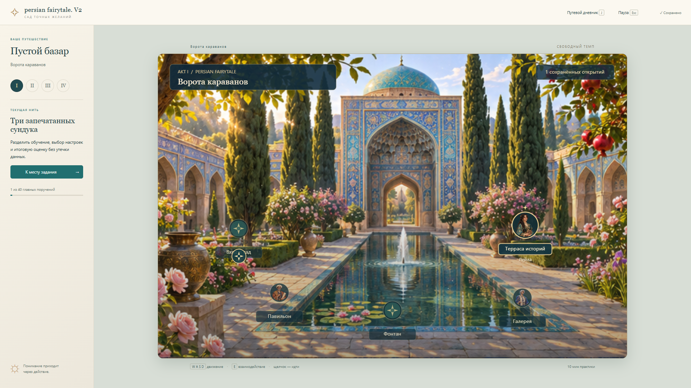
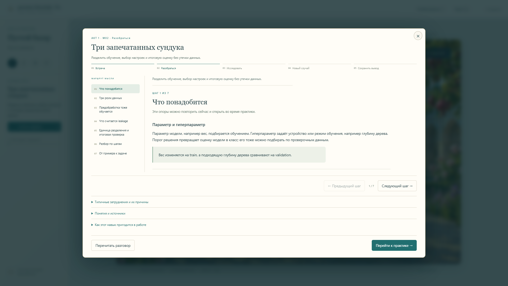
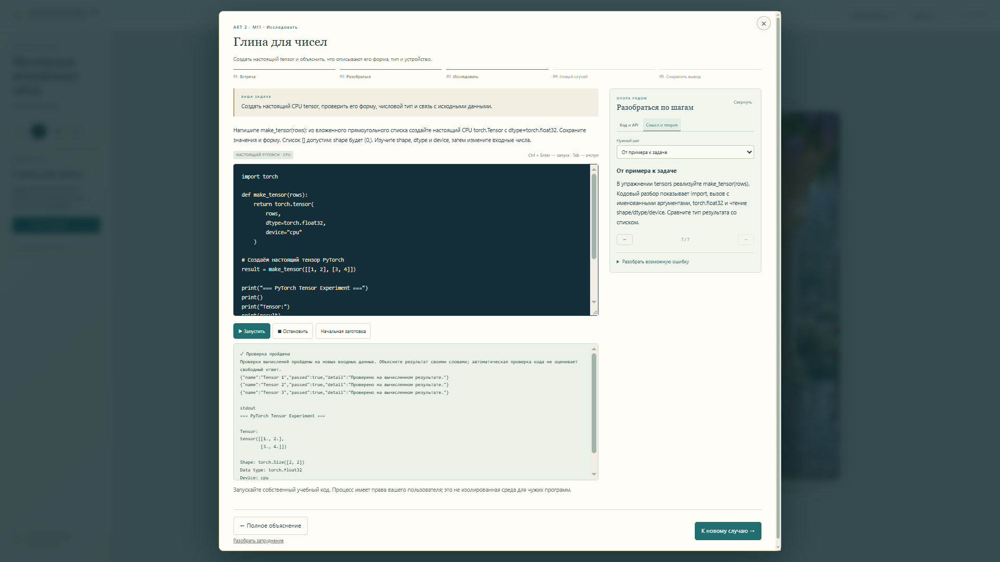
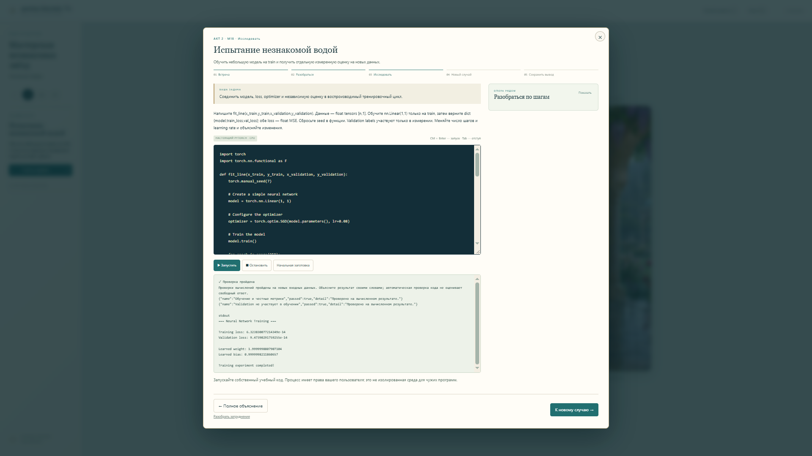

# Persian Fairytale

**An Interactive Journey Through Machine Learning**

Persian Fairytale is an illustrated educational adventure that combines a fantasy-inspired world with hands-on machine learning experiments using Python and PyTorch.

Explore four gardens, complete 40 learning missions, experiment with real neural networks, and develop a practical understanding of modern AI systems.

## 📸 Screenshots

### Explore a Persian-Inspired World

### Interactive Machine Learning Lessons

### Hands-on PyTorch Exercises

### Neural Network Training

*Screenshots from the current Russian-language edition. English localization and responsive UI improvements are planned.*

---

## ✨ Features

- **40 learning missions** across four acts, from ML fundamentals to modern language models and agentic systems.
- **Hands-on Python and PyTorch** exercises covering tensors, autograd, neural network training, and attention mechanisms.
- **Interactive training visualizations** based on actual computations.
- **An illustrated fantasy environment** with exploration, characters, dialogue, and progression.
- **Optional local model integration** through an OpenAI-compatible HTTP endpoint for limited agent-and-tool experiments.
- **Offline learning** after dependency installation, without mandatory paid APIs or model downloads.
- **Save and resume** functionality for learning progress.

## 🧠 Topics Covered

- Machine learning fundamentals and evaluation metrics
- Classical ML models
- Neural networks and PyTorch
- Transformers and attention
- Retrieval-Augmented Generation (RAG)
- AI agents and tool use
- Model evaluation and reliability

The experience combines conceptual lessons, worked examples, programming exercises, and feedback.

## 🚀 Getting Started

**Requirements**

- Windows
- 64-bit Python 3.10–3.13
- A modern web browser
- PyTorch and NumPy

**Installation**

1. Download the repository using **Code → Download ZIP**.
2. Extract the downloaded archive.
3. Run `INSTALL_DEPENDENCIES.bat` to install dependencies if needed.
4. Launch `START_GAME.bat`.

Smaller neural network experiments can run on CPU. A dedicated GPU is not required for the core learning experience.

Detailed installation instructions are available in [docs/START_RU.md](docs/START_RU.md).

## 🎮 Controls

| Key | Action |
|---|---|
| WASD / Arrow keys | Movement |
| E / Space | Interaction |
| J | Journal |
| Esc | Pause |
| Ctrl + Enter | Execute exercise code |

## 🏗️ Project Structure

| Path | Purpose |
|---|---|
| `data/` | Learning content and curriculum |
| `static/` | Game interface, illustrations, and assets |
| `exercises.py` | Practical ML exercises |
| `model_adapter.py` | Optional local model integration |
| `server.py` | Local application server |
| `launcher.py` | Application launcher |
| `saves.py` | Save management |
| `notebooks/` | Standalone educational notebooks |
| `tests/` | Automated tests |
| `docs/` | Documentation and test reports |

## 🧪 Testing and Limitations

The project includes automated tests and a documented verification report.

Development checks were performed using Linux, CPU-based PyTorch, and Chromium. These results do not constitute full verification on Windows.

Exercise code executes locally with the user's permissions. Process isolation and timeouts are not a security sandbox for untrusted code.

The local AI integration is optional and does not currently provide general-purpose evaluation of freely written student reasoning.

See [docs/TEST_REPORT.md](docs/TEST_REPORT.md) for testing details.

## 🗺️ Future Development

Potential improvements include:

- Local LLM-based feedback on written reasoning
- More interactive learning scenarios
- Improved accessibility and user experience
- Additional experiments and educational challenges

These features are planned concepts, not current functionality.

## 📚 Additional Information

- [Sources](docs/SOURCES.md)
- [Asset credits](docs/ASSETS.md)
- [Testing report](docs/TEST_REPORT.md)

## Project Status

**Experimental educational project — active development.**

Persian Fairytale is a portfolio project exploring interactive learning, practical machine learning education, and the integration of programming exercises into game-like experiences.
